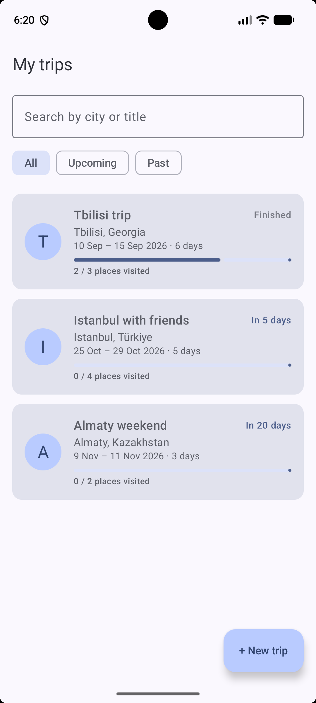
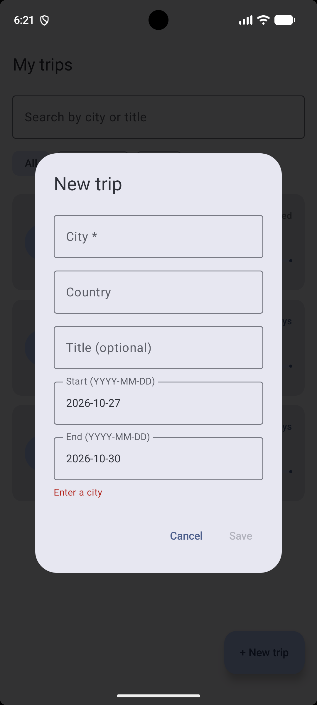
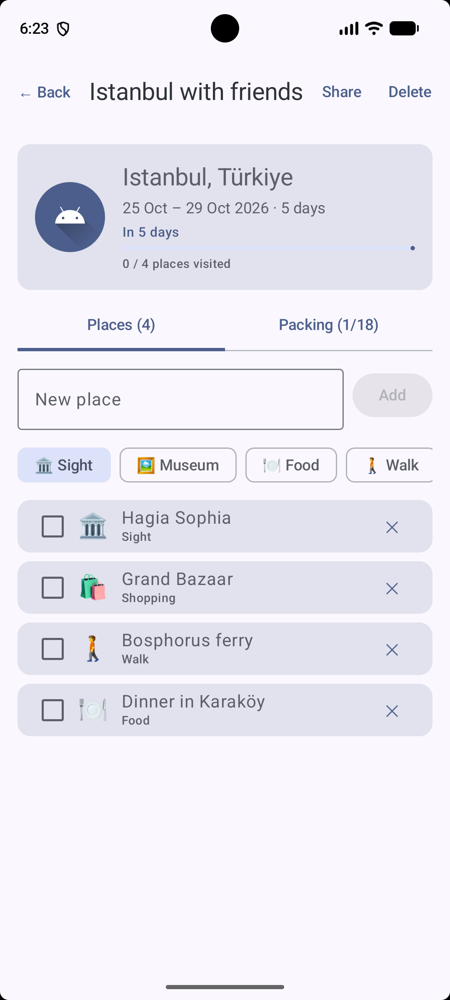
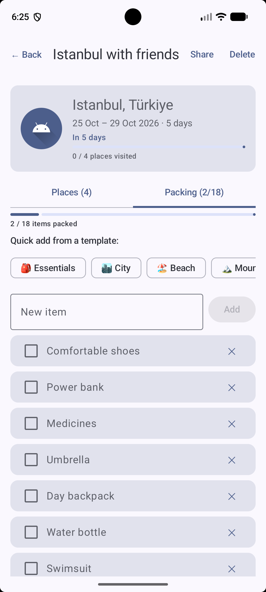
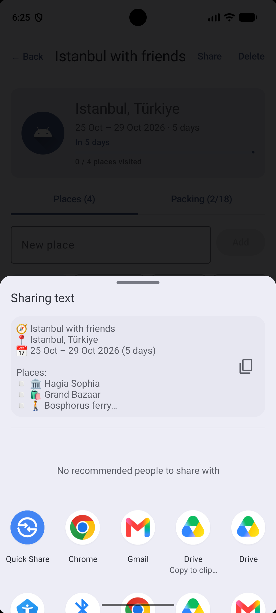
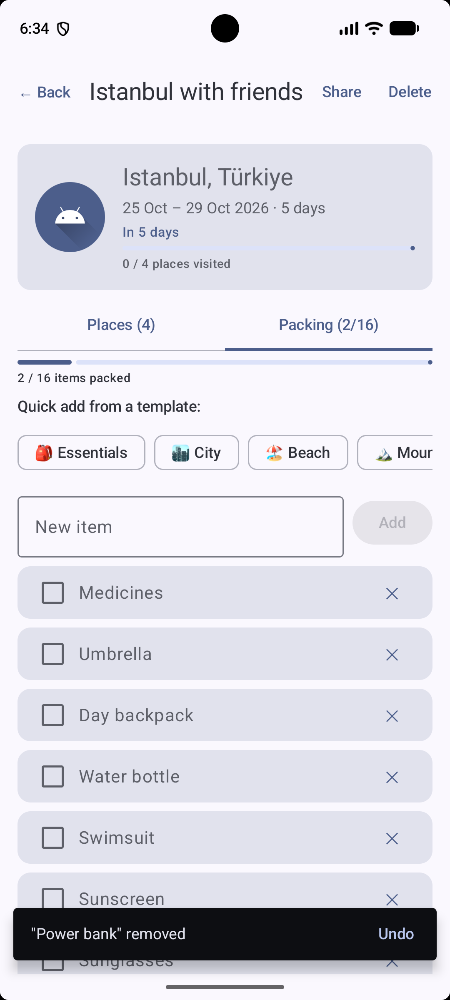

# Trip Planner (Android)

An Android app that helps you get ready for a trip: plan the places you want to visit,
pack your bag with smart checklists, and share the plan with your travel companions.

Built with **Kotlin**, **Jetpack Compose** and **Material 3**.

## Screenshots


| Trips list | New trip | Places |
|---|---|---|
|  |  |  |

| Packing list | Share | Undo delete |
|---|---|---|
|  |  |  |

## Features

- **Trips list** — search by city or title, filter *All / Upcoming / Past*, sorted by date.
- **Trip status & countdown** — "In 5 days", "Tomorrow", "Now · day 2 of 5", "Finished".
- **New trip** — dialog with validation (city required, valid dates, end not before start).
- **Places to visit** — add a place with a category (🏛 🖼 🍽 🚶 🛍), tick it off when visited, progress bar.
- **Packing list** — add items, tick them off (packed items move to the bottom), progress bar.
- **Packing templates** — one tap adds a ready list (*Essentials, City, Beach, Mountains*); duplicates are skipped.
- **Undo** — deleted places and items can be restored from a snackbar.
- **Share** — sends the trip plan (places + what is still to pack) to Telegram, WhatsApp, SMS, etc.
- **Screen rotation** — data, open tab and typed text are kept.

## How to run

1. Clone the repository and open the folder in **Android Studio**.
2. Wait for Gradle sync to finish.
3. Select an emulator or device with **Android 8.0 (API 26) or newer** and press **Run ▶**.

The app starts with three demo trips, so there is something to try right away.

## Project structure

```
app/src/main/java/com/example/tripplanner/
├── MainActivity.kt            # entry point, chooses which screen to show
├── data/
│   ├── Models.kt              # Trip, Place, PackingItem, PlaceCategory (immutable data classes)
│   ├── PackingTemplates.kt    # ready-made packing lists
│   └── SampleData.kt          # demo trips
└── ui/
    ├── TripsViewModel.kt      # screen state (StateFlow) + all user actions
    ├── TripsListScreen.kt     # list, search, filters, "New trip" dialog
    ├── TripDetailScreen.kt    # header, Places / Packing tabs, undo, share
    └── components/
        └── Components.kt      # reusable composables
```

## Architecture

```
UI (Composables) ──events──► TripsViewModel ──new TripsUiState (StateFlow)──► UI redraws
```

- **Unidirectional data flow:** screens get state and callbacks; they never change data themselves.
- **ViewModel** holds the app data and all logic (search, filtering, adding, toggling, templates, undo).
- **State** is an immutable data class; every change creates a new copy with `copy()`, so Compose always notices it.
- Data is in memory for now; the ViewModel is the single place to plug in Room or the backend API later.

## State management

| Tool | Used for | Why |
|---|---|---|
| `ViewModel` + `StateFlow` | trips, places, packing items, search query, filter | app data; outlives the Activity, so it survives rotation |
| `rememberSaveable` | open tab, typed text, chosen category, "New trip" dialog | UI state the user would not want to lose on rotation (saved to `Bundle`) |
| `remember` | `SnackbarHostState`, coroutine scope | temporary UI objects that can't be saved and needn't be: after rotation the undo message simply disappears |

## Compose components

Reusable composables: `TripCard`, `TripStatus`, `CityBadge`, `VisitedProgress` (used for places and packing),
`PlaceRow`, `PackingRow`, `AddItemField` (used in both tabs), `AppLogo`, `EmptyState`.

Layouts: `Row`, `Column`, `Box`, `LazyColumn`, `Card`, `Image`, `TabRow`, `Scaffold` with `TopAppBar` and `SnackbarHost`.
Inputs: `OutlinedTextField`, `Button`, `Checkbox`, `FilterChip`, `AssistChip`.