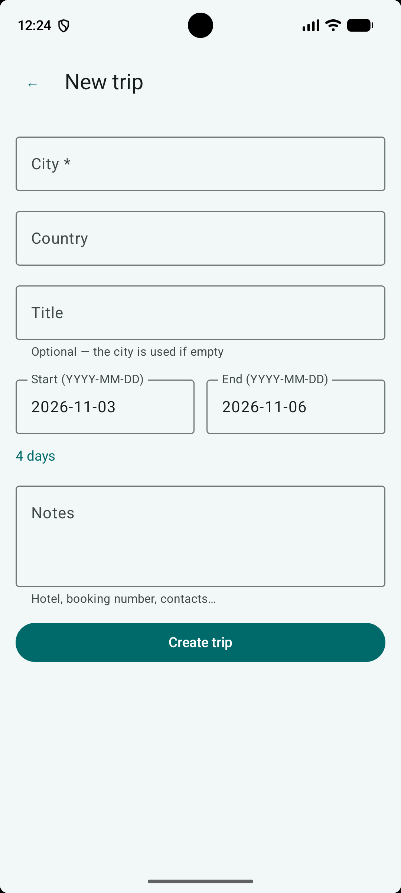
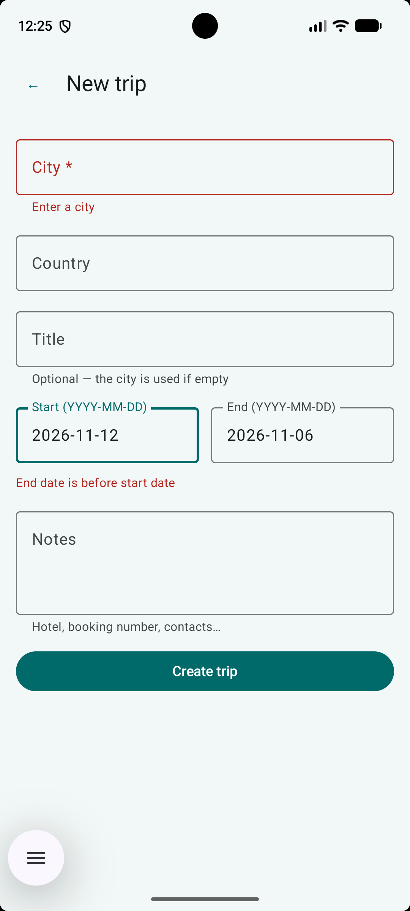
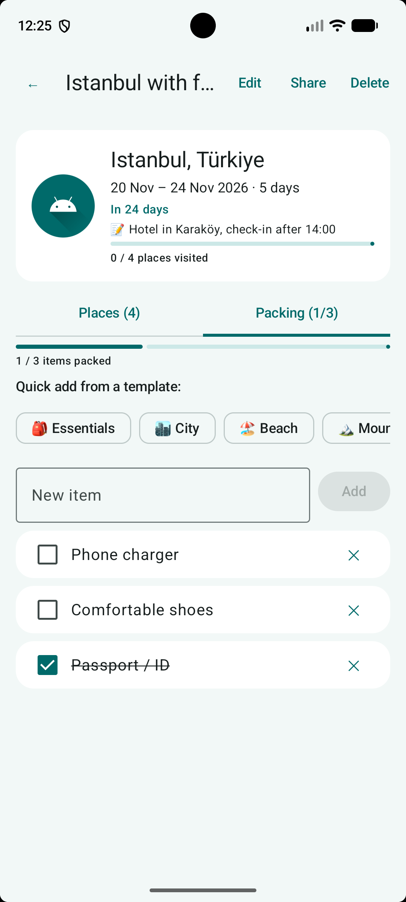
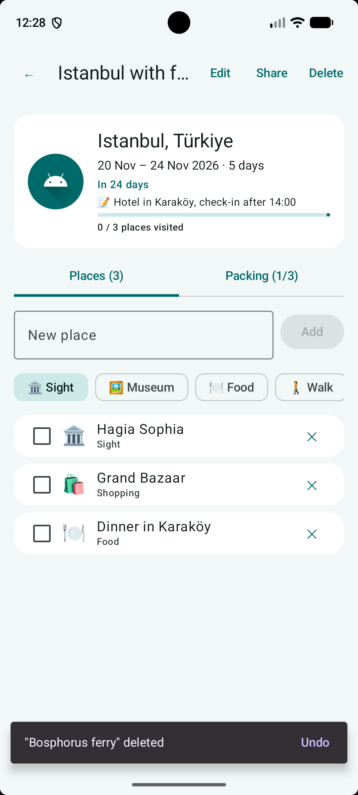
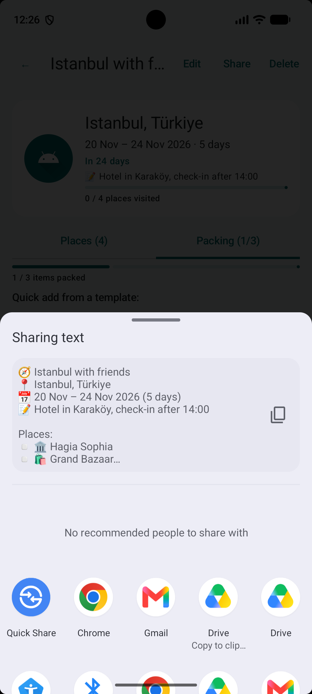
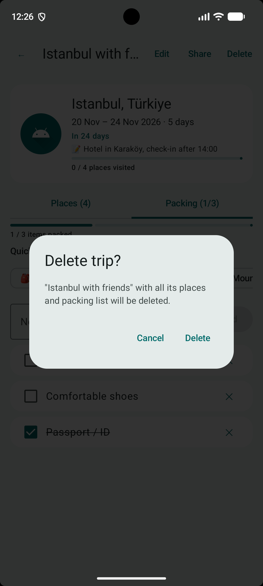

# Trip Planner (Android)

An Android app that helps you get ready for a trip: plan the places you want to visit,
pack your bag with smart checklists, keep trip notes and share the plan with your travel companions.

Built with **Kotlin**, **Jetpack Compose**, **Material 3** and **Navigation Compose**.


## Screenshots

| Trips | New trip | Form validation |
|---|---|---|
|  |  |  |

| Places | Packing list | Undo delete |
|---|---|---|
|  |  |  |

| Share | Delete trip |
|---|---|
|  |  |

## Features

- **Trips list** — search by city, country or title (debounced), filter *All / Upcoming / Past*, sorted by date.
- **Trip status & countdown** — "In 5 days", "Tomorrow", "Now · day 2 of 5", "Finished".
- **Create and edit trips** — a separate form screen with validation (city required, valid dates, end not before start) and a live "N days" preview.
- **Trip notes** — hotel, booking number, contacts; shown on the trip screen and included when sharing.
- **Places to visit** — add a place with a category (🏛 🖼 🍽 🚶 🛍 📍), tick it off when visited, progress bar.
- **Packing list** — add items, tick them off (packed items move to the bottom), progress bar.
- **Packing templates** — one tap adds a ready list (*Essentials, City, Beach, Mountains*); duplicates are skipped.
- **Undo** — deleted places and packing items can be restored from a snackbar, at their old position.
- **Safe delete** — deleting a trip asks for confirmation.
- **Share** — sends the trip plan (dates, notes, places, what is still to pack) to Telegram, WhatsApp, SMS, etc.
- **Configuration changes** — data, open tab, dialogs and typed text survive screen rotation.

## How to run

1. Clone the repository and open the folder in **Android Studio**.
2. Wait for Gradle sync to finish.
3. Select an emulator or device with **Android 8.0 (API 26) or newer** and press **Run ▶**.

The app starts with three demo trips, so there is something to try right away.
Data is kept in memory for now, so it resets when the app is closed (persistence is planned for the second half of the course).

## Navigation

Three screens connected with **Navigation Compose** (`ui/TripPlannerNavHost.kt`):

```
trips ──tap a trip──► trip/{tripId} ──Edit──► trip_form?tripId={tripId}
  │
  └──+ New trip──► trip_form ──Create──► trip/{newId}   (the form is removed from the back stack)
```

- The trip id is passed as a route argument (`NavType.LongType`); the ViewModel reads it from `SavedStateHandle`.
- System "Back" works through the navigation back stack.
- After a trip is deleted, the trip screen returns to the list automatically.

## Architecture

```
UI (Route + stateless Screen)  ──events──►  ViewModel  ──suspend calls──►  TripRepository
            ▲                                   │                              │
            └────────── UiState (StateFlow) ◄───┴──────── Flow<List<Trip>> ◄───┘
```

| Layer | Files | Responsibility |
|---|---|---|
| **Data** | `data/Models.kt`, `data/TripRepository.kt`, `data/SampleData.kt`, `data/PackingTemplates.kt` | Immutable models; `TripRepository` is the single source of truth (in memory now, Room or the backend API later) |
| **Logic** | `TripsListViewModel`, `TripDetailViewModel`, `TripFormViewModel` | One ViewModel per screen; exposes `StateFlow<UiState>`; handles all user actions |
| **UI** | `TripsListScreen`, `TripDetailScreen`, `TripFormScreen`, `components/Components.kt` | `...Route` connects to the ViewModel; `...Screen` is stateless and only gets state + callbacks |
| **App** | `TripPlannerApplication`, `MainActivity` | Creates the shared repository; hosts the navigation graph (single-activity) |

- **Unidirectional data flow:** state goes down, events go up.
- **Immutable state:** every change creates a new copy with `copy()`, so `StateFlow` and Compose always notice it.
- **Lifecycle-aware collection:** screens use `collectAsStateWithLifecycle()`, so collection pauses when the app is in the background.
- **Coroutines & Flow:** repository functions are `suspend` and called with `viewModelScope.launch`;
  the list screen combines trips, search and filter with `combine` + `debounce` + `stateIn`;
  snackbars use `rememberCoroutineScope`; navigation after saving uses `LaunchedEffect`.
- **Dependency injection (manual):** the repository is created once in `TripPlannerApplication`
  and passed to every ViewModel through `viewModelFactory`.

## State management

| Tool | Used for | Why |
|---|---|---|
| `ViewModel` + `StateFlow` | trips, search query, filter, trip form fields | app state and logic; outlives the Activity, so it survives rotation |
| `SavedStateHandle` | `tripId` navigation argument | passed from the route into the ViewModel |
| `rememberSaveable` | open tab, chosen category, typed place / item name, delete dialog | UI state the user would not want to lose on rotation (saved to `Bundle`) |
| `remember` | `SnackbarHostState`, coroutine scope | temporary UI objects that can't be saved and needn't be |
| **State hoisting** | all `...Screen` composables, `TripFormScreen` fields | values come from the state, changes go up through callbacks |

## Project structure

```
app/src/main/java/com/example/tripplanner/
├── MainActivity.kt              # entry point: theme + navigation
├── TripPlannerApplication.kt    # creates the shared repository
├── data/
│   ├── Models.kt                # Trip, Place, PackingItem, PlaceCategory
│   ├── PackingTemplates.kt      # ready-made packing lists
│   ├── SampleData.kt            # demo trips
│   └── TripRepository.kt        # repository interface + in-memory implementation
└── ui/
    ├── TripPlannerNavHost.kt    # routes and navigation graph
    ├── TripsListScreen.kt       # screen 1: list, search, filters
    ├── TripsListViewModel.kt
    ├── TripDetailScreen.kt      # screen 2: header, Places / Packing tabs, undo, share
    ├── TripDetailViewModel.kt
    ├── TripFormScreen.kt        # screen 3: create / edit form
    ├── TripFormViewModel.kt
    ├── components/
    │   └── Components.kt        # reusable composables
    └── theme/                   # colors, typography, shapes (Material 3)
```

## Compose components

Reusable composables: `TripCard`, `TripStatus`, `CityBadge`, `VisitedProgress` (places and packing),
`PlaceRow`, `PackingRow`, `AddItemField` (both tabs), `LabeledTextField` (trip form), `AppLogo`, `EmptyState`.

Material 3: `Scaffold`, `TopAppBar`, `LazyColumn`, `Card`, `TabRow`, `FilterChip`, `AssistChip`,
`OutlinedTextField`, `Checkbox`, `Button`, `AlertDialog`, `SnackbarHost`, `LinearProgressIndicator`, `Image`.

The app uses its own Material 3 color scheme (sea teal + sunset coral) for light and dark themes.