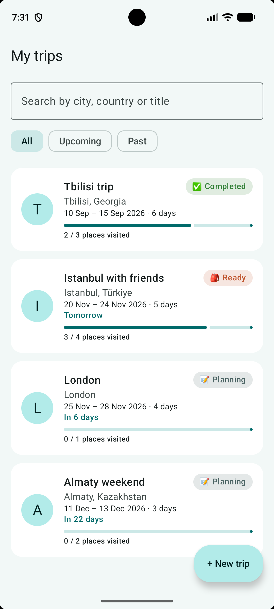
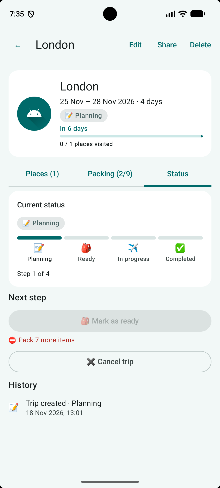
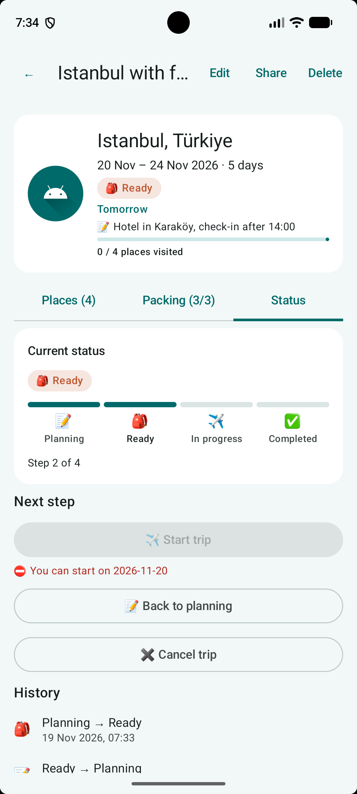
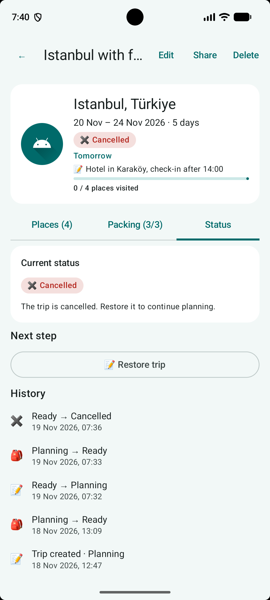
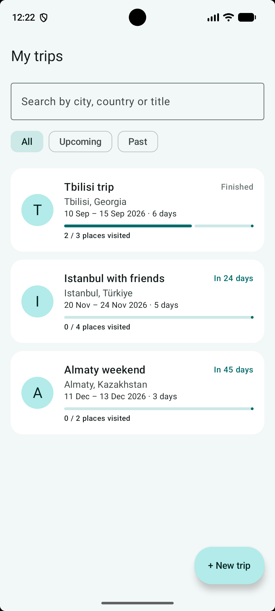
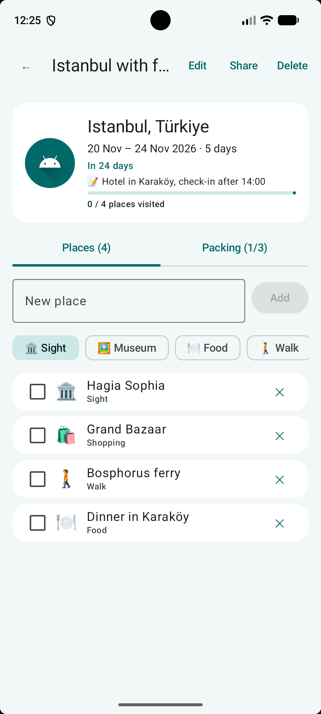

# Trip Planner (Android)

An Android app that helps you get ready for a trip: plan the places you want to visit,
pack your bag with smart checklists, move the trip through its stages from planning to the end,
keep trip notes and share the plan with your travel companions.

Built with **Kotlin**, **Jetpack Compose**, **Material 3**, **Navigation Compose** and **Room**.

## Trip status workflow (additional feature)

Every trip goes through stages. Moving to the next stage is allowed only when its condition is met,
and every change is saved to the history in the database.

| Trips with statuses | Planning: blocked step | Ready | History |
|---|---|---|---|
|  |  |  |  |

```
PLANNING ──→ READY ──→ IN PROGRESS ──→ COMPLETED
   │  ↑        │
   │  └────────┘  back to planning
   ↓
CANCELLED ──→ PLANNING  (restore)
```

| Transition | Condition |
|---|---|
| Planning → Ready | at least one place, and every packing item is packed |
| Ready → In progress | the start date has come |
| In progress → Completed | all places are visited, or the last day has come |
| Ready → Planning, → Cancelled, Cancelled → Planning | always |

- A disabled button shows the reason, e.g. "⛔ Pack 2 more items" or "⛔ You can start on 2026-11-20".
- The **Status** tab shows the current stage on a 4-step bar, the possible next steps and the full history with date and time.
- Every trip card in the list shows a colored status badge; a change on the Status tab appears in the list at once.
- The rules live in `data/TripWorkflow.kt` and are checked again in the repository before saving,
  so the UI can't skip them.
- The new status and its history record are saved in one Room transaction.
- A snackbar confirms every change ("Status changed to 🎒 Ready").

## Screenshots

| Trips | New trip | Form validation |
|---|---|---|
|  |  |  |

| Places | Packing list | Undo delete |
|---|---|---|
|  |  |  |

| Share | Delete trip |
|---|---|
|  |  |

## Features

- **Trips list** — search by city, country or title (debounced), filter *All / Upcoming / Past*, sorted by date, a status badge on every card.
- **Trip status workflow** — *Planning → Ready → In progress → Completed* (or *Cancelled*) with conditions and history (see above).
- **Countdown** — "In 5 days", "Tomorrow", "Now · day 2 of 5", "Finished".
- **Create and edit trips** — a separate form screen with validation (city required, valid dates, end not before start) and a live "N days" preview.
- **Trip notes** — hotel, booking number, contacts; shown on the trip screen and included when sharing.
- **Places to visit** — add a place with a category (🏛 🖼 🍽 🚶 🛍 📍), tick it off when visited, progress bar.
- **Packing list** — add items, tick them off (packed items move to the bottom), progress bar.
- **Packing templates** — one tap adds a ready list (*Essentials, City, Beach, Mountains*); duplicates are skipped.
- **Undo** — deleted places and packing items can be restored from a snackbar, at their old position.
- **Safe delete** — deleting a trip asks for confirmation; the trip's places, packing list and history are deleted with it.
- **Share** — sends the trip plan (status, dates, notes, places, what is still to pack) to Telegram, WhatsApp, SMS, etc.
- **Persistent data** — everything is stored in a local Room database and stays after the app is closed.
- **Configuration changes** — data, open tab, dialogs and typed text survive screen rotation.

## How to run

1. Clone the repository and open the folder in **Android Studio**.
2. Wait for Gradle sync to finish.
3. Select an emulator or device with **Android 8.0 (API 26) or newer** and press **Run ▶**.

On the first launch the database is filled with three demo trips, so there is something to try right away.
After that, all trips you create, change or delete are kept in the database between launches.

## Navigation

Three screens connected with **Navigation Compose** (`ui/TripPlannerNavHost.kt`):

```
trips ──tap a trip──► trip/{tripId} ──Edit──► trip_form?tripId={tripId}
  │
  └──+ New trip──► trip_form ──Create──► trip/{newId}   (the form is removed from the back stack)
```

- The trip id is passed as a route argument (`NavType.LongType`); the ViewModel reads it from `SavedStateHandle`.
- System "Back" works through the navigation back stack.
- When a trip disappears from the database, its screen returns to the list automatically.

## Architecture (MVVM)

```
UI (Route + stateless Screen) ──events──► ViewModel ──suspend calls──► TripRepository ──► TripDao ──► Room (SQLite)
            ▲                                │                                                │
            └──── UiState (StateFlow) ◄──────┴────────────── Flow<List<Trip>> ◄───────────────┘
```

| Layer | Files | Responsibility |
|---|---|---|
| **UI** | `TripsListScreen`, `TripDetailScreen`, `TripFormScreen`, `components/` | `...Route` connects to the ViewModel; `...Screen` is stateless and only gets state + callbacks |
| **ViewModel** | `TripsListViewModel`, `TripDetailViewModel`, `TripFormViewModel` | One ViewModel per screen; exposes `StateFlow<UiState>`; handles all user actions |
| **Domain** | `data/Models.kt`, `data/TripWorkflow.kt`, `data/PackingTemplates.kt` | Immutable models (`Trip`, `Place`, `PackingItem`, `TripStatus`, `StatusChange`) and the status rules |
| **Repository** | `data/TripRepository.kt`, `data/RoomTripRepository.kt` | Single source of truth: one method per user action, transactions, mapping between entities and models |
| **Data source** | `data/local/` | Room entities, DAO, database, type converter |
| **App** | `TripPlannerApplication`, `MainActivity` | Creates the database and the repository once; hosts the navigation graph (single-activity) |

- **Unidirectional data flow:** state goes down, events go up. Composables never change data themselves.
- **Reactive UI:** Room returns `Flow`, so after every insert, update or delete the new data reaches every screen without manual refreshing.
- **Lifecycle-aware collection:** screens use `collectAsStateWithLifecycle()`, so collection pauses when the app is in the background.
- **Coroutines:** DAO writes are `suspend` functions called with `viewModelScope.launch`, off the main thread;
  the list screen combines trips, search and filter with `combine` + `debounce` + `stateIn`.
- **Dependency injection (manual):** the database and repository are created once in `TripPlannerApplication`
  and passed to every ViewModel through `viewModelFactory`.

## Database (Room)

| Entity (table) | Fields | Relation |
|---|---|---|
| `TripEntity` (`trips`) | id, title, city, country, startDate, endDate, notes, status | — |
| `PlaceEntity` (`places`) | id, tripId, name, category, visited, position | many → one trip, `CASCADE` |
| `PackingItemEntity` (`packing_items`) | id, tripId, name, packed, position | many → one trip, `CASCADE` |
| `StatusChangeEntity` (`status_changes`) | id, tripId, fromStatus, toStatus, changedAt | many → one trip, `CASCADE` |

- `TripDao` reads a trip together with its places, packing list and history as `TripWithDetails`
  (`@Embedded` + `@Relation`) and returns it as `Flow`.
- Full CRUD: `insert...`, `observeTrips` / `observeTrip` / `getTrip`, `updateTrip` / `updateStatus` / `toggle...`, `delete...`.
- Several related writes (new trip + its first history record, status + history) run in `withTransaction`.
- `position` keeps the order of places and packing items, so Undo puts an item back where it was.
- `LocalDate` is stored as an epoch day with a `TypeConverter`; enums are stored as text.
- Demo trips are added only on the very first launch.

## State management

| Tool | Used for | Why |
|---|---|---|
| Room `Flow` → `ViewModel` + `StateFlow` | trips, trip details, status buttons | persistent app state; outlives the Activity, so it survives rotation |
| `MutableStateFlow` in the ViewModel | search query, filter, trip form fields | screen state that is not stored in the database |
| `Channel` → `receiveAsFlow()` | snackbar messages after an action | one-time events: shown once, not repeated after rotation |
| `SavedStateHandle` | `tripId` navigation argument | passed from the route into the ViewModel |
| `rememberSaveable` | open tab, chosen category, typed place / item name, delete dialog | UI state the user would not want to lose on rotation (saved to `Bundle`) |
| `remember` | `SnackbarHostState`, coroutine scope | temporary UI objects that can't be saved and needn't be |
| **State hoisting** | all `...Screen` composables, `TripFormScreen` fields | values come from the state, changes go up through callbacks |

## Project structure

```
app/src/main/java/com/example/tripplanner/
├── MainActivity.kt              # entry point: theme + navigation
├── TripPlannerApplication.kt    # creates the database and the repository, adds demo trips once
├── data/
│   ├── Models.kt                # Trip, Place, PackingItem, PlaceCategory, TripStatus, StatusChange
│   ├── TripWorkflow.kt          # status transitions and their conditions
│   ├── PackingTemplates.kt      # ready-made packing lists
│   ├── SampleData.kt            # demo trips for the first launch
│   ├── TripRepository.kt        # repository interface
│   ├── RoomTripRepository.kt    # repository implementation on Room
│   └── local/
│       ├── Entities.kt          # 4 Room entities + TripWithDetails
│       ├── TripDao.kt           # queries (Flow) and writes (suspend)
│       ├── TripDatabase.kt      # @Database, single instance
│       ├── Converters.kt        # LocalDate <-> Long
│       └── Mappers.kt           # entities <-> domain models
└── ui/
    ├── TripPlannerNavHost.kt    # routes and navigation graph
    ├── TripsListScreen.kt       # screen 1: list, search, filters, status badges
    ├── TripsListViewModel.kt
    ├── TripDetailScreen.kt      # screen 2: header, Places / Packing / Status tabs, undo, share
    ├── TripDetailViewModel.kt
    ├── TripFormScreen.kt        # screen 3: create / edit form
    ├── TripFormViewModel.kt
    ├── components/
    │   ├── Components.kt        # reusable composables
    │   └── StatusComponents.kt  # status badge, step bar, transition button, history row
    └── theme/                   # colors, typography, shapes (Material 3)
```

## Compose components

Reusable composables: `TripCard`, `TripCountdown`, `CityBadge`, `VisitedProgress` (places and packing),
`PlaceRow`, `PackingRow`, `AddItemField` (both tabs), `LabeledTextField` (trip form), `AppLogo`, `EmptyState`,
`StatusBadge` (card and header), `StatusStepper`, `StatusActionRow`, `HistoryRow`.

Material 3: `Scaffold`, `TopAppBar`, `LazyColumn` (stable item keys), `Card`, `TabRow`, `FilterChip`, `AssistChip`,
`OutlinedTextField`, `Checkbox`, `Button`, `OutlinedButton`, `AlertDialog`, `SnackbarHost`, `LinearProgressIndicator`, `Image`.

The app uses its own Material 3 color scheme (sea teal + sunset coral) for light and dark themes.